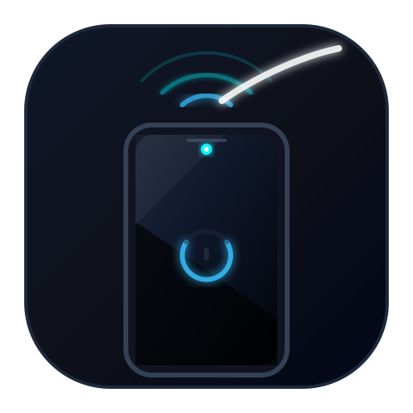

  

<h1 align="center">Proximit</h1>

  A tiny, hidden Android app that turns the screen off when you cover the
  proximity sensor — <strong>without locking the device</strong>.

Proximit has **no launcher shortcut**; the only entry point is a **Quick
Settings tile**.

## Screen off, not locked

Android has no public API that lets a normal app permanently turn the screen off
while keeping the device unlocked. The closest supported behaviour is the
proximity screen-off wake lock used here:

- The screen goes off only while the sensor is covered and comes back on when it
  is uncovered.
- The device stays unlocked, so there is no PIN/pattern/biometric prompt when
  the screen returns.
- Because the wake lock is held while the sensor is covered, Android may keep
  the CPU awake during that time on some devices. Disable the tile when you do
  not need it, especially if the phone will sit in a pocket for a long time.
- Some devices do not expose this wake lock level. The setup screen reports
  `Screen-off mode: not supported` and the tile is marked unavailable.

To uninstall, simply uninstall Proximit. There is no device administrator to
remove first.

## Notes and limitations

- The app is hidden from the launcher but still appears in Android Settings.
- The Quick Settings tile must be added manually on most devices.
- Some OEM skins (Xiaomi, Samsung, etc.) may kill background services. If the
  gesture stops working, allow Proximit to run in the background / disable
  battery optimization for it.
- No internet permission is requested.

## License

Copyright (C) 2026 shinbhairava

Proximit is free software: you can redistribute it and/or modify it under the
terms of the GNU General Public License as published by the Free Software
Foundation, either version 3 of the License, or (at your option) any later
version.

Proximit is distributed in the hope that it will be useful, but **without any
warranty**; without even the implied warranty of **merchantability** or
**fitness for a particular purpose**. See the [GNU General Public
License](LICENSE) for more details.

You should have received a copy of the GNU General Public License along with
Proximit. If not, see <https://www.gnu.org/licenses/>.
